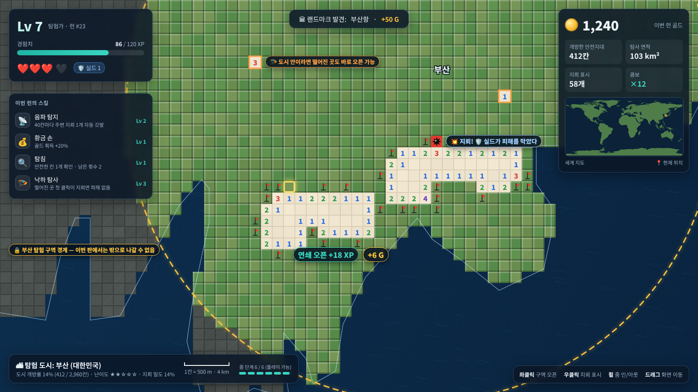
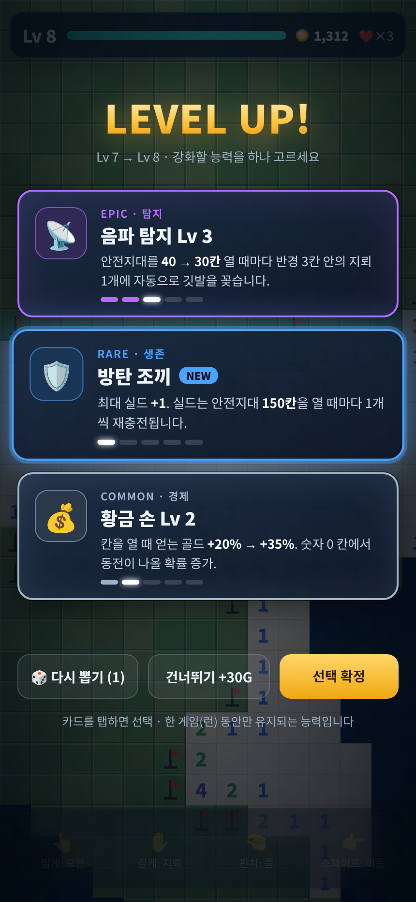
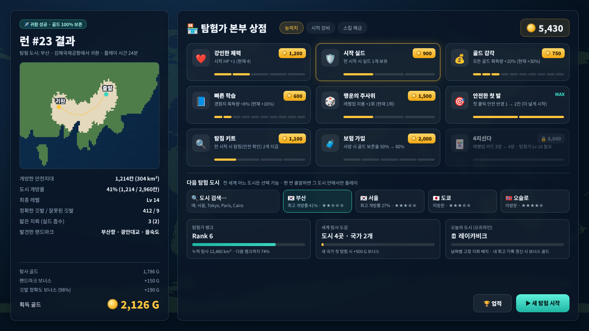

# 월드 마인스위퍼 (가제) — 게임 기획안 v2

> 실제 세계지도를 500m 격자로 나눈 지뢰밭에서, 내가 고른 도시 하나를 탐험하는 로그라이트 지뢰찾기 웹게임
> PC(마우스) · 모바일(터치) 동시 지원 · 오프라인 전용

### v2 확정 사항
| # | 항목 | 결정 |
|---|---|---|
| 1 | 바다 | **건널 수 있음** — 도시 경계 안이라면 섬·건너편 해안도 바로 클릭 가능 |
| 2 | 사망 시 골드 | **50% 보존** |
| 3 | 서버 | **오프라인 전용** (랭킹·계정 서버 없음) |
| 4 | 출발지 | **세계 어느 도시든 선택**. 한 번 시작하면 다른 도시로 넘어갈 수 없고, **같은 도시 안에서는 어디든 클릭 가능** |
| 5 | PC 조작 | 왼쪽 클릭 = 구역 오픈, 오른쪽 클릭 = 지뢰 표시, 휠 = 줌 인/아웃, 드래그 = 화면 이동 |
| 6 | 모바일 조작 | 짧게 탭 = 구역 오픈, 길게 누르기 = 지뢰 표시, 두 손가락 벌리기/좁히기 = 줌 인/아웃, 스와이프 = 화면 이동 |

---

## 1. 게임 개요

| 항목 | 내용 |
|---|---|
| 장르 | 지뢰찾기 + 로그라이트 (뱀파이어 서바이버류 성장 구조) |
| 플랫폼 | 웹 브라우저 (PC / 모바일), PWA로 홈 화면 설치 · 오프라인 실행 |
| 맵 | 실제 세계지도. 육지 = 지뢰밭, 바다 = 열 수 없는 빈 공간 |
| 플레이 범위 | 한 판(런) = **도시 하나**. 도시 경계 밖으로는 나갈 수 없음 |
| 1칸 크기 | 약 500m × 500m (1칸 = 0.25km²) |
| 한 판 길이 | 15~30분 목표, 자동 저장 후 이어하기 가능 |
| 핵심 재미 | ① 지뢰찾기 추론 ② 레벨업마다 3지선다 스킬 빌드 ③ 골드로 영구 성장 ④ "우리 동네를 지도에서 직접 열어본다"는 탐험감 |

### 핵심 루프

```
[본부/상점] → 세계지도에서 탐험할 도시 선택 → [런 시작]
   → 도시 안 어디든 클릭해서 칸 열기 → 경험치(XP)·골드 획득
   → 레벨업 → 스킬 3개 중 1개 선택 (이번 런 한정)
   → 귀환 / 도시 정복 / HP 0 → [결과 정산] → 골드로 영구 업그레이드 → 다음 도시 선택
```

---

## 2. 맵 & 지뢰 규칙

### 2-1. 세계지도 격자
- **실제 해안선 데이터**(Natural Earth 1:10m)를 500m 격자로 바꿔 육지 칸만 플레이 영역으로 사용.
- 격자는 웹 메르카토르 기반 정사각 격자. **위도 35°(한국 부근)에서 정확히 500m**가 되도록 정의.
  - 적도 쪽은 칸이 약간 크고(≈610m), 북유럽 쪽은 작아짐(≈330m). "대략 500m" 감각을 유지하면서 구현이 가장 단순한 방식.

### 2-2. 탐험 도시 규칙 ★
- **도시 선택**: 시작 화면의 세계지도에서 고르거나 이름으로 검색 (예: 서울, Tokyo, Paris). 인구 1.5만 명 이상 도시 약 2.6만 곳을 내장.
- **도시 경계**:
  - MVP: 도시 중심에서 일정 반경(인구 규모별 8~20km) 안의 육지.
  - 이후: 실제 행정구역 경계(예: 부산광역시 경계)로 교체.
- **이동 제한**: 한 번 출발하면 그 도시에 고정. 경계 밖 칸은 회색으로 잠겨 있고 클릭할 수 없음.
- **자유 클릭**: 경계 안이라면 이미 연 영역과 붙어 있지 않은 칸도 **어디든 바로 열 수 있음**.
  - 단, 아무 정보 없이 떨어진 곳을 여는 것은 "찍기"라 지뢰 밀도만큼 위험 → 스킬 "🪂 낙하 탐사"로 보완.
- **바다 건너기**: 바다 칸은 열 수 없는 빈 공간일 뿐 장벽이 아님. 경계 안의 섬(예: 부산 가덕도, 영도)이나 만 건너편 해안도 바로 클릭할 수 있음. 항구·다리 같은 별도 이동 수단은 필요 없음.
- **도시 규모 예시**: 부산(반경 13km)은 육지 약 2,960칸. 큰 도시일수록 칸이 많아 오래 플레이할 수 있고, 클리어 보상도 큼.

### 2-3. 지뢰 규칙
- 기본 규칙은 고전 지뢰찾기와 같음. 숫자는 주변 8칸의 지뢰 수이고, 0이면 주변이 자동으로 연쇄 오픈됨.
- 바다 칸과 경계 밖 칸에는 지뢰가 없고, 숫자 계산에서 0으로 취급.
- **배치 시점**: 런의 첫 클릭 직후 도시 전체에 한 번에 배치. 시드 기반이라 같은 시드면 같은 배치.
- **첫 클릭 안전**: 첫 클릭 지점 주변 3×3은 지뢰 없음 보장 (영구 업그레이드로 5×5까지).

### 2-4. 구역 난이도
도시 안에서도 구역마다 지뢰 밀도가 다르다. 판이 고정되어 있으므로 밀도는 처음 배치할 때 정해진다.

| 구역 | 판정 기준 (MVP) | 지뢰 밀도 | 특수 지뢰 |
|---|---|---|---|
| 도심 | 도시 중심에서 반경 30% 이내 | 12% | — |
| 시가지 | 30~70% | 15% | 대전차 지뢰 소수 |
| 외곽 | 70% 이상 | 18% | 대전차 지뢰, 재머 지뢰 |

- 도시 전체 기본 난이도(★1~5)를 이 표에 더한다. 예: 사막·산악 도시는 +2~4%p.
- 대전차 지뢰는 밟으면 HP -2.
- 재머 지뢰는 주변 숫자를 `?`로 가린다.

### 2-5. 특수 칸
| 칸 | 효과 |
|---|---|
| 💰 보물 상자 | 열면 골드 대량 획득 |
| 🏛 랜드마크 | 실제 지명(예: 부산항, 광안대교). 첫 발견 시 골드·XP 보너스 |
| ✈️ 귀환 포인트 | 공항·항구·기차역 칸. 이 칸이 열려 있으면 언제든 **귀환** 가능 |
| ❤️ 구급 상자 | HP 1 회복 (드물게 등장) |

---

## 3. 조작

### 3-1. PC (마우스)
| 동작 | 입력 |
|---|---|
| 구역 오픈 | **왼쪽 클릭** |
| 지뢰 표시 / 해제 | **오른쪽 클릭** (깃발 토글, 브라우저 우클릭 메뉴는 막음) |
| 줌 인 / 줌 아웃 | **마우스 휠** (커서 위치 기준으로 확대·축소) |
| 화면 이동 | **드래그** |
| 스킬 사용 | 화면의 스킬 버튼 클릭 |
| 보조: 주변 일괄 오픈 | 열린 숫자 칸을 왼쪽 클릭하면, 주변 지뢰 표시 수가 숫자와 같을 때 나머지 주변 칸을 한 번에 오픈 (설정에서 끌 수 있음) |

- 클릭과 드래그 구분: 버튼을 누른 채 5px 이상 움직이면 드래그로 보고, 놓아도 칸을 열지 않음.

### 3-2. 모바일 (터치)
| 동작 | 입력 |
|---|---|
| 구역 오픈 | **짧게 탭** |
| 지뢰 표시 / 해제 | **길게 누르기** (약 0.4초, 진동 피드백) |
| 줌 인 / 줌 아웃 | **두 손가락 벌리기 / 좁히기** (핀치) |
| 화면 이동 | **한 손가락 스와이프** |
| 스킬 사용 | 하단 스킬 버튼 탭 |

- 오조작 방지 규칙:
  - 손가락이 10px 이상 움직이면 스와이프로 판정하고 칸을 열지 않음.
  - 두 번째 손가락이 닿는 순간 진행 중이던 탭·길게 누르기를 취소.
  - 칸이 너무 작게 보이는 배율(28px 미만)에서 탭하면 칸을 열지 않고 그 지점으로 확대.

### 3-3. 줌 단계
도시에 고정되므로 세계·국가 단위 줌은 도시 선택 화면에서만 쓴다.

| 단계 | 칸 크기 | 표시 |
|---|---|---|
| 1 도시 전체 | 1~4px | 도시 경계 전체, 열린 영역 색 표시, 랜드마크 아이콘 |
| 2 구역 | 5~19px | 칸 경계 표시, 숫자 숨김 |
| 3~4 플레이 | 20px 이상 (모바일 28px 이상) | 숫자·지뢰 표시, **이 단계에서 칸 조작**. 화면 폭은 PC 약 30km, 모바일 약 7km |

---

## 4. 경험치 & 레벨업 (런 한정 성장)

### 4-1. 경험치 획득
| 행동 | XP |
|---|---|
| 직접 클릭으로 연 안전 칸 | 2 |
| 연쇄(0)로 자동으로 열린 칸 | 0.5 |
| 지뢰 표시가 정답으로 확정됨 | 1 |
| 랜드마크 발견 | 20 |

- 필요 XP는 `30 + 15 × (현재 레벨 − 1)`. Lv1→2는 30, Lv7→8은 120, Lv14→15는 225.
- 대략 **안전지대 20~60칸마다 1레벨** 체감. 한 런에서 Lv 12~18 도달이 목표.

### 4-2. 레벨업 화면
- 게임이 일시정지되고 **카드 3장 중 1장 선택**.
- 카드 등급: 일반(회색) / 레어(파랑) / 에픽(보라) / 전설(금색).
- **다시 뽑기**는 기본 1회이고 영구 업그레이드로 늘어남. **건너뛰기**를 하면 골드를 조금 받음.
- 스킬은 최대 5레벨. 한 런에서 최대 6개까지 보유.

### 4-3. 스킬 목록 (초안)
| 분류 | 스킬 | 효과 (Lv1 → Max) |
|---|---|---|
| 탐지 | 📡 음파 탐지 | 안전 칸을 40칸 → 20칸 열 때마다 근처 지뢰 1개에 자동으로 지뢰 표시 |
| 탐지 | 🔍 탐침 | 고른 칸이 안전한지 확인 (사용 횟수 2 → 6, 레벨업 시 충전) |
| 탐지 | 🧲 금속 탐지기 | 지정한 지점 주변 3×3의 지뢰 수 표시 (쿨다운 있음) |
| 탐지 | 🛰 항공 사진 | 반경 10칸의 지뢰 밀도를 히트맵으로 표시 |
| 탐지 | 🚁 정찰 드론 | 100칸마다 아직 안 연 지역의 안전 칸 1~3개 자동 오픈 |
| 생존 | 🛡️ 방탄 조끼 | 실드 +1 (지뢰 피해 1회 무효), 150칸마다 재충전 |
| 생존 | ❤️ 강철 체력 | 최대 HP +1, 즉시 1 회복 |
| 생존 | 🩹 응급 처치 | 레벨업 시 HP 회복 확률 20% → 60% |
| 생존 | 🧯 불발탄 | 지뢰를 밟아도 10% → 30% 확률로 불발 |
| 생존 | 🪂 **낙하 탐사** | 열린 영역과 떨어진 칸을 처음 열 때 지뢰면 피해 없이 지뢰 표시로 바뀜 (쿨다운 100칸 → 40칸) |
| 경제 | 💰 황금 손 | 골드 획득 +20% → +80% |
| 경제 | 🗝 보물 사냥꾼 | 보물 상자 방향 표시, 상자 골드 +50% |
| 경제 | 🔧 지뢰 해체반 | 정답 지뢰 표시 1개당 골드 +1 → +3 |
| 성장 | 📘 빠른 학습 | XP +15% → +60% |
| 성장 | ⚡ 연쇄 반응 | 연쇄 오픈 칸 XP 0.5 → 1.5 |
| 성장 | 🍀 행운 | 레어 이상 카드 등장 확률 증가 |

**진화 (뱀서식 조합)** — 두 스킬을 모두 최대 레벨로 만들면 레벨업 카드에 진화형이 등장한다.
- 음파 탐지 + 항공 사진 → **🌍 위성 스캔**: 300칸마다 화면 안 지뢰의 30% 공개
- 방탄 조끼 + 불발탄 → **🦾 폭발물 처리 슈트**: 실드가 있을 때 지뢰를 밟으면 해체 처리 + 골드 획득
- 낙하 탐사 + 정찰 드론 → **🪖 공수 부대**: 떨어진 곳 첫 오픈 시 주변 3×3 중 안전 칸 자동 오픈
- 황금 손 + 보물 사냥꾼 → **👑 미다스**: 숫자 0 칸에서 동전 등장

---

## 5. 골드 & 런 종료

### 5-1. 골드 획득처
| 출처 | 양 |
|---|---|
| 안전 칸 오픈 | 칸당 확률적으로 1~3G |
| 보물 상자 | 30~150G |
| 랜드마크 첫 발견 | 50G |
| 지뢰 표시 정확도 보너스 (런 종료 시) | 정확도 90% 이상이면 정답 표시 수 × 0.5G |
| 새 국가 첫 탐험 | 500G (나라별 1회) |
| 오늘의 도시 최고 기록 갱신 | 200G |

### 5-2. 런 종료 조건
| 종료 방식 | 조건 | 골드 보존율 |
|---|---|---|
| ✈️ **귀환** | 열려 있는 귀환 포인트에서 "귀환" 선택 | **100%** |
| 🏆 **도시 정복** | 도시의 안전 칸을 모두 오픈 | **100% + 정복 보너스(도시 칸 수 × 0.3G)** |
| 💀 **사망** | HP 0 | **50%** (영구 업그레이드 "보험"으로 최대 75%) |

→ "더 열어서 더 벌 것인가, 지금 귀환할 것인가"를 고민하게 만든다.

### 5-3. HP
- 기본 HP는 3. 지뢰를 밟으면 HP -1(대전차 지뢰는 -2)이고, 실드가 있으면 실드가 먼저 깎인다.
- 밟은 지뢰는 공개되면서 자동으로 지뢰 표시가 되고, 게임은 그대로 계속된다.

---

## 6. 상점 (영구 업그레이드, 런 사이에만 이용)

### 6-1. 능력치
| 업그레이드 | 효과 / 레벨 | 최대 | 비용(예시) |
|---|---|---|---|
| ❤️ 강인한 체력 | 시작 HP +1 | 5 | 600 → 1,200 → 2,400 … |
| 🛡️ 시작 실드 | 런 시작 시 실드 +1 | 3 | 900 → |
| 💰 골드 감각 | 골드 획득 +10% | 10 | 250 → (×1.5씩 증가) |
| 📘 빠른 학습 | XP +8% | 10 | 300 → |
| 🎲 행운의 주사위 | 레벨업 다시 뽑기 +1 | 3 | 1,500 → |
| 🎯 안전한 첫 발 | 첫 클릭 안전 범위 3×3 → 5×5 | 2 | 800 → |
| 🔍 탐침 키트 | 시작 시 탐침 +1 | 4 | 1,100 → |
| 🧳 보험 가입 | 사망 시 골드 보존 +5%p (50% → 75%) | 5 | 2,000 → |

### 6-2. 해금
- **스킬 해금**: 새 스킬을 레벨업 카드 풀에 추가 (처음에는 기본 8개만 등장).
- **4지선다**: 레벨업 카드 3장 → 4장 (고가, 탐험가 랭크 조건).
- (선택) 꾸미기: 지뢰 표시 깃발 디자인, 칸 스킨, 폭발 이펙트.
- 도시는 처음부터 전부 열려 있음 (해금 대상 아님).

### 6-3. 메타 진행 (모두 기기 안에 저장)
- **탐험가 랭크**: 누적 탐사 면적(km²)으로 오름. 상점 상위 항목의 해금 조건.
- **세계 탐사 도감**: 탐험한 도시·국가·랜드마크 수집. 도시별 최고 개방률 기록.
- **오늘의 도시**: 날짜로 정해지는 도시와 지뢰 배치. 서버 없이 내 최고 기록과 경쟁.

---

## 7. 화면 구성

| 화면 | 주요 요소 |
|---|---|
| 타이틀/본부 | 세계지도 배경, 시작 / 상점 / 도감 / 설정 |
| 도시 선택 | 세계지도 + 도시 검색, 도시 정보(면적·칸 수·난이도·내 최고 개방률) |
| 게임 플레이 | 지도·격자·도시 경계선, 레벨·XP 바, HP·실드, 골드, 보유 스킬, 미니맵, 도시 개방률, 축척 |
| 레벨업 | 카드 3장, 다시 뽑기, 건너뛰기 |
| 결과 정산 | 탐사 지도, 개방 칸·면적·도시 개방률, 지뢰 표시 정확도, 골드 내역 |
| 상점 | 탭(능력치 / 시작 장비 / 스킬 해금), 보유 골드, 다음 탐험 도시 |

### 게임 장면 예시

**① PC 게임 플레이 — 부산 탐험 구역 (노란 점선 = 도시 경계, 밖의 회색 지역은 진입 불가, 주황 테두리 = 떨어진 곳을 바로 연 칸)**


**② 모바일 레벨업 — 스킬 3지선다 (하단: 터치 조작 안내)**


**③ 런 결과 정산 + 영구 업그레이드 상점 + 다음 탐험 도시 선택**


> 위 이미지는 Natural Earth 1:10m 해안선 데이터를 실제로 500m 격자로 바꿔 그린 컨셉 목업이다. 수치와 문구는 예시.

---

## 8. 기술 설계 (요약) — 오프라인 전용

| 영역 | 방식 |
|---|---|
| 클라이언트 | TypeScript + Vite, 렌더링은 **PixiJS(WebGL)** — 수천 칸을 60fps로 그리기 위해 |
| 배포 | 정적 파일만 사용. 서비스 워커로 전체 캐시 → **첫 접속 후 인터넷 없이 실행** (PWA) |
| 입력 | Pointer Events로 마우스와 터치를 함께 처리. 3장의 판정 규칙(드래그 5px, 스와이프 10px, 길게 누르기 0.4초, 핀치 시 탭 취소)을 한곳에서 구현 |
| 지도 데이터 | 1:10m 육지 데이터(수 MB)와 도시 목록(약 2.6만 곳, 한/영 이름)을 내장. 도시를 고르면 그 도시 영역만 즉석에서 500m 격자로 변환 |
| 지뢰 생성 | 첫 클릭 후 시드 기반으로 도시 전체에 배치 (도시당 최대 수만 칸 → 메모리 부담 없음) |
| 연쇄 오픈 | 너비 우선 탐색을 프레임마다 최대 N칸씩 나눠 처리 → 큰 0 영역에서도 멈추지 않고 퍼지는 연출 |
| 저장 | 진행 중인 런(열린 칸·지뢰 표시 비트셋, 시드, 스킬)과 골드·업그레이드·도감 → IndexedDB 자동 저장. 기기 변경 대비 **저장 코드 내보내기/가져오기** 제공 |

---

## 9. 밸런스 & 리스크 메모
- **자유 클릭과 찍기**: 떨어진 곳을 여는 건 순수한 확률 게임 → 지뢰 밀도가 곧 위험도. 낙하 탐사, 탐침, HP로 부담을 조절.
- **연쇄 오픈 폭주**: 넓은 0 영역이 한 번에 수천 칸 열리면 XP가 과해짐 → 연쇄로 열린 칸 XP를 낮게(0.5) 책정.
- **도시 크기 편차**: 작은 도시는 금방 정복됨 → 칸 수에 비례한 정복 보너스. 너무 작은 도시(500칸 미만)는 반경을 넓혀 최소 크기 보장.
- **해안선 해상도**: 1:10m 데이터는 500m 격자 대비 다소 거칠다 → 이후 지역별 고해상도 데이터 팩(선택 다운로드)을 검토.
- **모바일 성능**: 화면 밖 칸은 그리지 않고, 저배율에서는 칸 대신 텍스처 1장으로 그림.

---

## 10. 개발 단계 제안

| 단계 | 범위 |
|---|---|
| **MVP** | 도시 1곳(부산) 고정, 기본 규칙, 자유 클릭, PC·모바일 조작 전부, HP, XP/레벨업, 스킬 8종, 골드, 상점 6종, 자동 저장 |
| **알파** | 전 세계 도시 선택(검색 + 지도), 구역 난이도·특수 지뢰, 랜드마크·귀환 포인트, 스킬 16종 + 진화, 도시 정복 |
| **베타** | 오늘의 도시, 도감·업적, 실제 행정구역 경계, 저장 코드, 사운드·이펙트 다듬기 |
